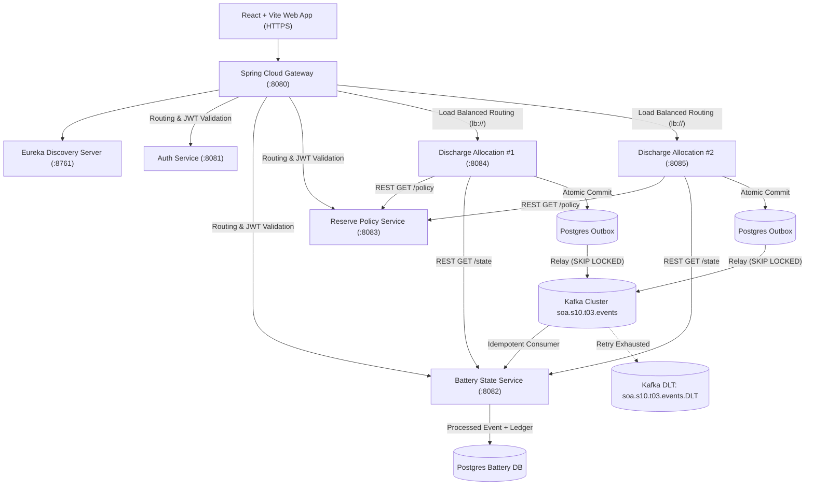

# Community Battery Reserve Priority (SOA s10.t03)

[](https://github.com/Aneesha2006-bot/CommunityBatterySOA/actions/workflows/ci.yml)
[](https://adoptium.net/)
[](https://spring.io/projects/spring-boot)
[](https://spring.io/projects/spring-cloud)
[](https://react.dev/)
[](web/scripts/check-contrast.cjs)

> **Decentralized Community Energy Storage Architecture** honoring regular member discharge allocations while mathematically defending a 30.0 kWh emergency reserve floor for life-critical services, backed by transactional outbox event choreography, optimistic concurrency control, zero-trust security, and DPDP Act 2023 compliance.

---

## 1. System Architecture



---

## 2. Monorepo Modules

| Module | Port | Technology | Primary Responsibility |
|---|---|---|---|
| [`common-domain`](common-domain/) | N/A | Pure Java 21 | Framework-free `ReserveAllocator` logic and boundary assertions. |
| [`discovery-server`](discovery-server/) | 8761 | Netflix Eureka | Microservice discovery registry. |
| [`api-gateway`](api-gateway/) | 8080 | Spring Cloud Gateway | Edge gateway, RS256 token validation, load balancing (`lb://`). |
| [`auth-service`](auth-service/) | 8081 | OAuth2/OIDC, Nimbus JWT | RS256 token issuer, JWKS public keys, DPDP consent tracking. |
| [`battery-state-service`](battery-state-service/) | 8082 | Spring Boot, Spring Kafka | Physical charge state, committed draw ledger, idempotent consumer. |
| [`reserve-policy-service`](reserve-policy-service/) | 8083 | Spring Boot, Spring Data JPA | Protected emergency reserve floor, member caps, optimistic locking (`@Version`). |
| [`discharge-allocation-service`](discharge-allocation-service/) | 8084, 8085 | Spring Boot, Spring Kafka | Discharge evaluation, transactional outbox (`SKIP LOCKED`), dual-instance HA. |
| [`web`](web/) | 3000 | React 18, Vite, TypeScript, Tailwind | WCAG 2.2 AA accessible SPA, live SVG battery gauge, DPDP intake. |
| [`infra`](infra/) | 5432, 9092 | Docker Compose | KRaft Kafka, isolated multi-database PostgreSQL schemas. |

---

## 3. Core Domain Rule & Edge Case Verification

Implemented in [`common-domain/src/main/java/com/communitybattery/domain/ReserveAllocator.java`](common-domain/src/main/java/com/communitybattery/domain/ReserveAllocator.java):
- $\text{shareablePool} = \max(0, \text{currentCharge} - \text{reserveFloor})$
- $\text{granted} = \min(\text{requested}, \text{shareablePool}, \text{remainingMemberDailyCap})$
- $\text{denied} = \text{requested} - \text{granted}$

### Verified Edge Case:
- **Given**: Capacity = 100 kWh, Current Charge = 68 kWh, Protected Floor = 30 kWh, Member Cap = 50 kWh.
- **When**: `member-b` requests **45.0 kWh**.
- **Then**:
  - Shareable Pool = $68.0 - 30.0 = 38.0\text{ kWh}$.
  - Granted = $\min(45.0, 38.0, 50.0) = \mathbf{38.0\text{ kWh}}$.
  - Denied = $45.0 - 38.0 = \mathbf{7.0\text{ kWh}}$ with reason code `RESERVE_PROTECTED`.
  - Status = `PARTIALLY_GRANTED`.
  - Final charge lands **exactly on the 30.0 kWh emergency floor**.
  - `RejectedRequest` persisted; `DischargeRequested` event emitted to Kafka via outbox.

---

## 4. Quick Start

### Run All Backend Tests (Maven):
```bash
mvn test
```

### Run Full Automated Demonstration Script:
```powershell
powershell -ExecutionPolicy Bypass -File scripts/run-demo.ps1
```

### Run Contract Break Verification (Schema Mutation Test):
```powershell
powershell -ExecutionPolicy Bypass -File scripts/verify-contract-break.ps1
```

### Run Web Frontend:
```bash
cd web
npm install
npm run check-contrast     # Audits WCAG 2.2 AA contrast ratios
npm run check-placeholders # Enforces business configuration credentials
npm run build              # Builds bundle and prerenders static HTML
npm run preview            # Local production preview at http://localhost:4173
```

### Launch Infrastructure (Docker Compose):
```bash
docker compose -f infra/docker-compose.yml up --build
```

---

## 5. Verification & Evidence Artifacts

- **Master Automated Demo Log**: [`docs/evidence/demo-run.txt`](docs/evidence/demo-run.txt)
- **Contract Break Failure Proof**: [`docs/evidence/contract-break-failure.txt`](docs/evidence/contract-break-failure.txt)
- **Contract Break Restored Proof**: [`docs/evidence/contract-break-restored.txt`](docs/evidence/contract-break-restored.txt)
- **Concurrent Load Test (20 VUs, p95 < 500ms)**: [`docs/evidence/load-test-report.txt`](docs/evidence/load-test-report.txt)
- **Course Outcome (CO1–CO4) Matrix**: [`docs/co-mapping.md`](docs/co-mapping.md)
- **Architecture & Eventual Consistency Analysis**: [`docs/architecture.md`](docs/architecture.md)
- **Security & Zero-Trust Architecture**: [`docs/security.md`](docs/security.md)
- **Event Contracts & Outbox Reliability**: [`docs/events/events.md`](docs/events/events.md)
- **Compliance Registers & DPDP 2023 Inventory**: [`docs/compliance/`](docs/compliance/)
- **OpenAPI 3.0 Specifications**: [`docs/api/`](docs/api/)
- **Agile Scrum Artifacts**: [`docs/agile/`](docs/agile/)
