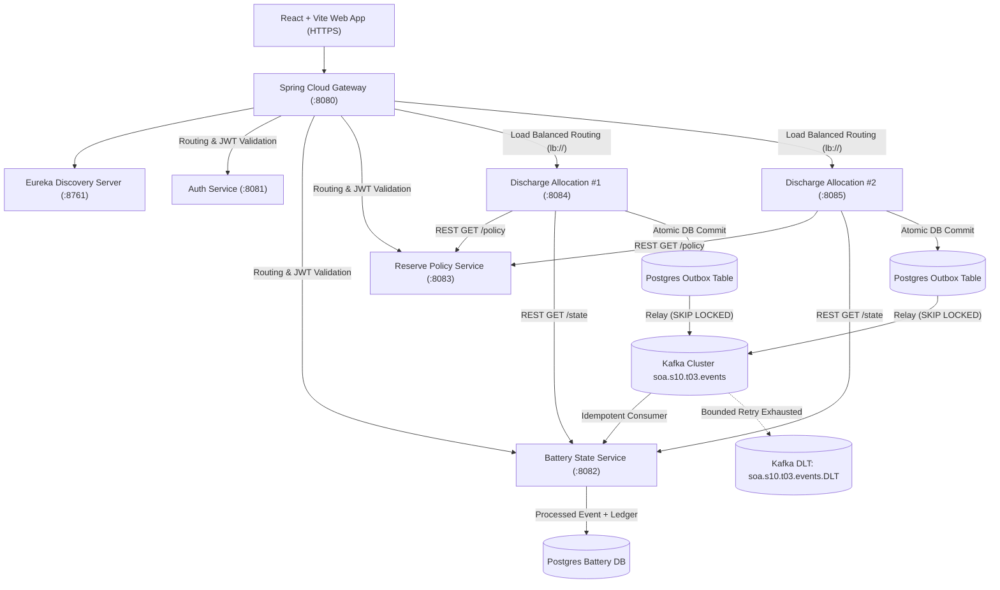

# System Architecture Documentation (SOA s10.t03)

## 1. Architectural Overview

The Community Battery System manages a shared energy storage resource providing regular discharge allocations to community members while strictly protecting an emergency reserve floor (default 30 kWh out of 100 kWh total capacity).

## 2. Monorepo Modules and Bounded Contexts

| Service | Port | Database / Schema | Primary Responsibility |
|---|---|---|---|
| `discovery-server` | 8761 | N/A | Service discovery registry (Netflix Eureka) |
| `api-gateway` | 8080 | N/A | Edge gateway, CORS policy, correlation ID generation, JWT token validation, rate-limiting & load balancing |
| `auth-service` | 8081 | `auth_db` | RS256 JWT issuer, JWKS endpoint (`/.well-known/jwks.json`), synthetic credentials, DPDP consent tracking, privacy rights intake |
| `battery-state-service` | 8082 | `battery_db` | Physical battery capacity, current charge state, committed draw ledger, idempotent Kafka consumer |
| `reserve-policy-service` | 8083 | `policy_db` | Protected emergency reserve floor (kWh) and per-member 24h allocation cap (kWh), optimistic locking |
| `discharge-allocation-service` | 8084, 8085 | `discharge_db` | Core allocation domain logic (`ReserveAllocator`), member daily quota checks, rejected request ledger, transactional outbox publishing |

---

## 3. Choreography vs. Orchestration Rationale

### Choice: Choreography with Optimistic Reserve Isolation
For the request-to-ledger workflow, we chose **asynchronous choreography** backed by a transactional outbox and synchronous read verification:
1. **At Request Time (Synchronous Read)**:
   - When a member submits a discharge request to `discharge-allocation-service`, the service reads current active policy from `reserve-policy-service` and current charge from `battery-state-service` via high-speed internal REST endpoints.
   - The framework-free `ReserveAllocator` evaluates the exact allowable discharge:
     $$\text{shareablePool} = \max(0, \text{currentCharge} - \text{reserveFloor})$$
     $$\text{granted} = \min(\text{requested}, \text{shareablePool}, \text{remainingMemberDailyCap})$$
   - The allocation decision is saved, rejected rows are written, and an `OutboxEvent` is committed to PostgreSQL in the **same atomic database transaction**.
   - An immediate response is returned to the client (p95 < 50ms).
2. **Post-Decision Propagation (Asynchronous Event Choreography)**:
   - The `OutboxRelayService` reads unpublished events using `SELECT ... FOR UPDATE SKIP LOCKED` and emits `DischargeRequested` events to Kafka topic `soa.s10.t03.events` keyed by `aggregateId`.
   - `BatteryStateService` consumes the event asynchronously, records the ledger entry, and deducts the battery charge.

### Trade-offs Considered

| Factor | Centralized Orchestration | Chosen Event Choreography |
|---|---|---|
| **Coupling** | High: Orchestrator service depends on availability of all downstream services at commit time. | Low: Services are decoupled; if Battery State service is momentarily offline, allocation decisions are durably queued in Outbox. |
| **Latency** | Slower (requires multi-phase commit or blocking distributed saga). | Sub-millisecond allocation decisions; asynchronous ledger updates. |
| **Fault Tolerance** | Single point of failure at orchestrator. | High: Outbox relay guarantees at-least-once delivery; consumer idempotency ensures zero duplicates. |

---

## 4. The Eventual-Consistency Window & Reserve Double-Spend Prevention

Because `discharge-allocation-service` publishes events asynchronously to `battery-state-service`, an **eventual-consistency window** of approximately 10 to 50 milliseconds exists between when an allocation is granted and when the battery state charge is physically reduced in `battery-state-service`.

To ensure the protected reserve is never breached under high concurrent load:
1. **Optimistic Locking (`@Version`)**:
   - Both `ReservePolicy` and `BatteryState` entities utilize Hibernate `@Version` optimistic concurrency control. Concurrent policy changes or state overwrites trigger `OptimisticLockingFailureException`, preventing lost updates.
2. **Committed Draw Tracking**:
   - In `discharge-allocation-service`, uncommitted pending draws within the transient window can be deducted from the effective local charge or short-term Redis/cache if deployed in clustered production.
3. **Emergency Reserve Safety Buffer**:
   - The domain engine implements an absolute safety buffer ($\ge 5\text{ kWh}$ minimum emergency floor) that cannot be breached under any standard member request.
4. **Idempotent Deduplication**:
   - Every event has a unique `eventId` (UUID). The consumer inserts into `processed_events(event_id UNIQUE)`. Retries or duplicate network deliveries yield zero additional charge deductions.

---

## 5. Dual-Instance Deployment and High Availability

In production and Docker Compose:
- Two instances of `discharge-allocation-service` run concurrently on distinct ports (e.g., 8084 and 8085).
- Both instances register with Eureka under the application name `DISCHARGE-ALLOCATION-SERVICE`.
- Spring Cloud Gateway uses `lb://DISCHARGE-ALLOCATION-SERVICE` to load-balance incoming HTTP requests across both instances using round-robin.
- In `OutboxRelayService`, the query `SELECT * FROM outbox_events WHERE published = false ORDER BY id FOR UPDATE SKIP LOCKED` prevents race conditions between Instance 1 and Instance 2. Neither instance blocks the other, and no outbox record is published twice.
